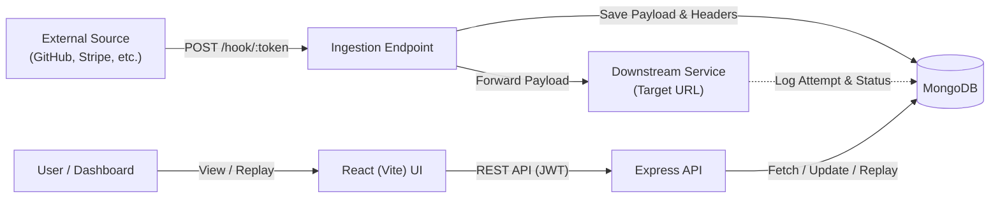

# Webhook Manager 🚀

A centralized, scalable Webhook Management & Monitoring platform built with **Node.js, Express, MongoDB (Mongoose), and React (Vite)**. 

Manage webhooks, ingest payloads through secure token-based endpoints, track delivery statuses, inspect raw event payloads, and easily replay failed webhook dispatches.

---

## ✨ Features

- **Centralized Webhook Control:** Register and configure multiple webhooks with custom downstream target URLs.
- **Secure Token-Based Ingestion:** Unique 32-character hexadecimal tokens per webhook for isolated, public ingestion (`POST /hook/:token`).
- **Comprehensive Event Logging:** Automatically persists incoming JSON payloads, HTTP headers, timestamps, and delivery attempt logs.
- **Delivery & Replay Engine:** Forwards incoming payloads to downstream target URLs. If a delivery fails, replay it on-demand with full retry tracking.
- **JWT-Based Authentication:** Protected endpoints with bcrypt-hashed passwords and secure JSON Web Tokens.
- **Interactive React Dashboard:**
  - Real-time webhook delivery metrics (`received`, `delivered`, `failed`).
  - Filterable, paginated event activity feed.
  - JSON payload viewer and delivery attempt inspector.
  - One-click event replay.

---

## 🛠️ Tech Stack

- **Backend:** Node.js, Express.js
- **Database & ODM:** MongoDB, Mongoose
- **Authentication:** JSON Web Tokens (JWT), Bcrypt.js
- **Frontend:** React 18, Vite, Modern CSS
- **Delivery Client:** Native Fetch API with `AbortSignal.timeout`

---

## 📡 RESTful API Endpoints (9 Endpoints)

| # | Method | Path | Auth | Purpose |
|:---:|:---:|:---|:---:|:---|
| **1** | `POST` | `/api/auth/register` | None | Register a new user account (returns JWT) |
| **2** | `POST` | `/api/auth/login` | None | Authenticate user credentials (returns JWT) |
| **3** | `POST` | `/api/webhooks` | JWT | Create a webhook with name & optional downstream target URL |
| **4** | `GET` | `/api/webhooks` | JWT | List all webhooks with delivery stats (`received`, `delivered`, `failed`) |
| **5** | `DELETE`| `/api/webhooks/:id` | JWT | Cascade-delete webhook and its associated events |
| **6** | `GET` | `/api/events` | JWT | List & filter events (`?status=`, `?webhook=`, `?page=`, `?limit=`) |
| **7** | `GET` | `/api/events/:id` | JWT | Retrieve event details, payload, headers, and delivery attempts |
| **8** | `POST` | `/api/events/:id/replay` | JWT | Re-deliver a failed event to the target URL |
| **9** | `POST` | `/hook/:token` | Token | Public ingestion endpoint receiving JSON payloads |

---

## 🏗️ Architecture & Event Flow



---

## 🗄️ MongoDB Schema Overview

- **User:** `email`, `password` (hashed).
- **Webhook:** `user`, `name`, `targetUrl`, `token` (unique random hex), `active`.
- **Event:**
  - `webhook`: Reference to Webhook
  - `user`: Reference to User
  - `payload`: Raw JSON data received
  - `headers`: Request headers (`host`, `content-type`, `user-agent`)
  - `status`: Enum (`'received'` \| `'delivered'` \| `'failed'`)
  - `attempts`: Array of delivery attempts containing `at` (timestamp), `statusCode`, `success`, and `error`.

---

## 🚀 Getting Started

### Prerequisites

- [Node.js](https://nodejs.org/) (v18 or higher recommended)
- [MongoDB](https://www.mongodb.com/) running locally or via MongoDB Atlas

### 1. Clone the Repository
```bash
git clone https://github.com/Priyanshu2068/Webhook-Manager.git
cd Webhook-Manager
```

### 2. Backend Setup
```bash
cd backend
npm install
```

Configure environment variables:
Create a `.env` file in the `backend/` directory:
```env
PORT=5000
MONGO_URI=mongodb://localhost:27017/webhook_manager
JWT_SECRET=your_jwt_secret_key_here
```

Start the backend server:
```bash
# Development mode with hot-reload
npm run dev

# Or production mode
npm start
```
The API runs on **`http://localhost:5000`**.

### 3. Frontend Setup
In a new terminal:
```bash
cd frontend
npm install
npm run dev
```
The dashboard runs on **`http://localhost:5173`** (pre-configured to proxy `/api` and `/hook` requests to port 5000).

---

## 🧪 Testing & cURL Examples

### 1. Ingest an Event (Simulate Webhook Producer)
Replace `<token>` with your webhook's ingestion token obtained from the dashboard:
```bash
curl -X POST http://localhost:5000/hook/<token> \
  -H "Content-Type: application/json" \
  -d '{"event": "payment.succeeded", "amount": 4900, "currency": "usd"}'
```

### 2. Replay an Event
```bash
curl -X POST http://localhost:5000/api/events/<event_id>/replay \
  -H "Authorization: Bearer <your_jwt_token>"
```

---

## 📁 Project Structure

```text
webhook-manager/
├── backend/
│   ├── src/
│   │   ├── middleware/
│   │   │   └── auth.js         # JWT verification middleware
│   │   ├── models/
│   │   │   ├── Event.js        # Event schema with delivery attempts
│   │   │   ├── User.js         # User authentication model
│   │   │   └── Webhook.js      # Webhook configuration model
│   │   ├── routes/
│   │   │   ├── auth.js         # Login & registration endpoints
│   │   │   ├── events.js       # Event inspection, listing, and replay
│   │   │   ├── ingest.js       # Public token-based ingestion
│   │   │   └── webhooks.js     # Webhook CRUD & analytics
│   │   ├── deliver.js          # Downstream dispatch & retry handler
│   │   └── server.js           # Server bootstrap & Express setup
│   ├── .env.example
│   └── package.json
├── frontend/
│   ├── src/
│   │   ├── api.js              # Fetch client with JWT authorization
│   │   ├── App.jsx             # React dashboard & event viewer
│   │   ├── main.jsx            # React root component
│   │   └── styles.css          # UI styles & themes
│   ├── index.html
│   ├── package.json
│   └── vite.config.js          # Vite configuration with proxy rules
├── .gitignore
└── README.md
```

---

## 📄 License

This project is licensed under the MIT License.
